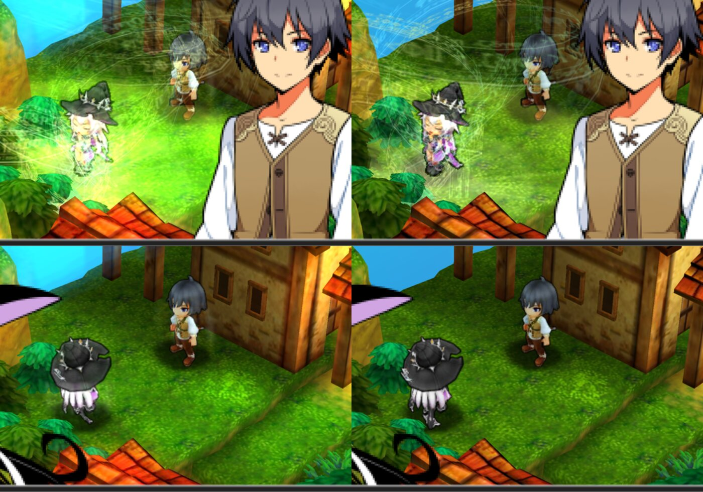

# Stella Glow No Bloom

A patch for Stella Glow (USA, 3DS) that removes the ghostly glow around characters at high resolution. Works in Azahar, Citra, Zakuro and on a real 3DS with Luma3DS.

## Features

- Removes the halo and ghost outlines around characters
- No more stripes under the battle cursor
- Works at any internal resolution
- Comes as a patch file or an Action Replay cheat
- Does nothing on a different game version

## How it works

- The game draws a soft glow by blurring a tiny copy of the screen.
- Emulators upscale that tiny copy, so the blur turns into sharp ghost copies.
- This patch turns the glow off at the source. The rest of the picture is unchanged.
- An HD texture pack can't fix it. The glow isn't a texture.

## Requirements

- Stella Glow, USA cartridge release (title ID `0004000000173700`)
- Azahar, Citra or Zakuro, or a 3DS with Luma3DS

## Install

Use the patch file. Use the cheat only if you can't use mods.

**Azahar or Citra**

1. Right-click Stella Glow in the game list and choose **Open Mods Location**.
2. Copy `patch/0004000000173700/code.ips` into that folder.
3. Start the game.

**Zakuro**

1. Click **Mods** next to Stella Glow in the library.
2. Copy `code.ips` into that folder.
3. Press **Recompile** next to the game.

**Real 3DS (Luma3DS)**

1. Copy `code.ips` to `luma/titles/0004000000173700/` on the SD card.
2. Hold **Select** while powering on and enable **Enable game patching**.

The file must keep the name `code.ips`.

**Cheat instead of patch**

Copy the code from `cheats/0004000000173700.txt` into your emulator's cheat list and enable **No Bloom (USA)**.

## Uninstall

Delete `code.ips` from the folder you copied it to, or disable the cheat.

## Troubleshooting

- Glow is still there: check your copy is the USA release.
- The cheat does nothing: use the patch file instead.
- The soft glow at 1x is gone too: that's expected.

More detail: [docs/USER_GUIDE.md](docs/USER_GUIDE.md).

## More

- [User guide](docs/USER_GUIDE.md)
- [AGENTS.md](AGENTS.md): how the bug was found and fixed, for developers and AI agents

## Support

https://ko-fi.com/sana748653

## Credits

- [Zakuro](https://github.com/fearkov/zakuro): the 3DS emulator used to trace the glow

## Licence

MIT

## How this was made

I started this project and used AI (Claude) to speed up development. I write, review and fix code by hand all the way through, keep the AI's work checked and reined in, and aim to keep the patch as lightweight as possible. I test it in Azahar and Zakuro on my own PC.
