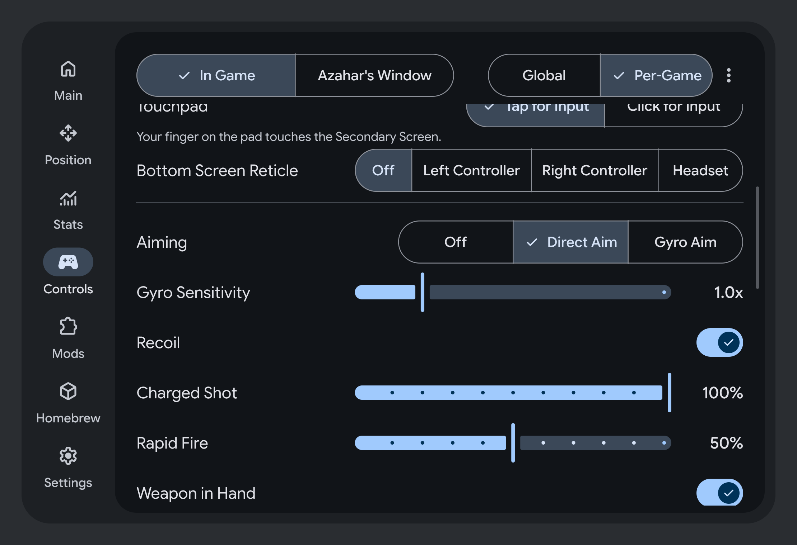
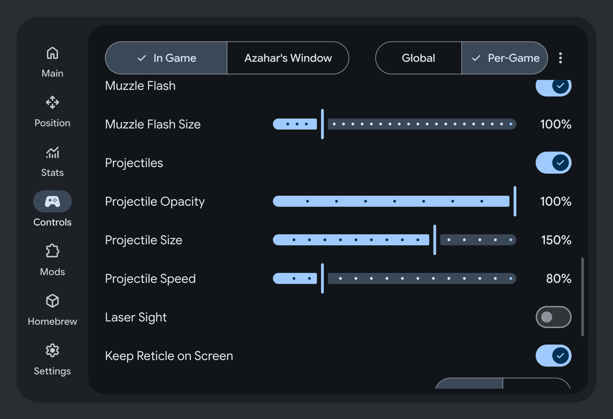

# Angel's Aim

A direct-aim, light-gun-style mode for Kid Icarus: Uprising in [Azahar for Frame](https://github.com/simplysanatori/AzaharFrame), on Valve's Steam Frame.

Alpha Pre-Release · Very Experimental · Have Fun!

**None of this would have been possible without Darkshade's [Kid Icarus: Uprising C-Stick & Gyro patch](https://gbatemp.net/threads/kid-icarus-uprising-c-stick-gyro-patch.685775/). Thank you, Darkshade.**

## Features

- **Direct Aim** (light gun mode): the reticle goes exactly where you point on the screen, at any screen size
- Point near or past the screen's edge to turn the camera (Turn Zone)
- 3D models of all 108 of the game's weapons are rendered as controller meshes you use while playing: Pit's equipped one is in your hand
- The models update live from the game's memory and are pulled directly from your own game files. Nothing is shipped.
- Shots, muzzle flashes and the laser sight leave your weapon's muzzle
- Haptic feedback on every shot
- Also supports **Gyro Aim**

## How it works

- The weapon models are built on your Frame from your own copy of Kid Icarus: Uprising.
  - Nothing from Kid Icarus: Uprising is hosted or shipped.
- It's the first step toward a full 6DOF Kid Icarus: Uprising VR mod.

## Requirements

- [Azahar for Frame](https://github.com/simplysanatori/AzaharFrame) 1.2.0 or later
- Your own copy of Kid Icarus: Uprising (tested on the USA version)
- Darkshade's C-Stick & Gyro patch (v172), installed from the app
- Recommended: my [Kid Icarus: Uprising HD](kid-icarus-uprising-hd.md) texture pack

## Set up

1. Start the game and open the in-game menu.
2. Go to **Mods**, then **Angel's Aim**.
3. Under **Required**, install **C-Stick & Gyro**, or its 16:9 or 21:9 version. Then start the game again.
4. Get **Kid Icarus: Uprising HD** from **Textures**, **Download Packs**, and turn it on.

**Aiming** starts on **Direct Aim** once the patch is installed. **Aiming Settings** in the same segment opens the rest.

## Settings people look for

- **Grip Frees Aim**: hold the aiming controller's grip to point at the bottom screen or a menu.
- **Turn Zone**, **Horizontal Turn Speed** and **Vertical Turn Speed**: where turning starts, and how fast.
- **Weapon in Hand**: the weapon's size, opacity, muzzle flash and projectiles.

Every setting: [Angel's Aim in the user guide](https://github.com/simplysanatori/AzaharFrame/blob/steam-frame/docs/USER_GUIDE.md#angels-aim-kid-icarus-uprising).

## Recommended settings

These are the settings I found most comfortable. Kid Icarus: Uprising starts on them.

| Setting | Value |
|---|---|
| Immersive Mode | Off |
| Aiming | Direct Aim |
| Bottom Screen Reticle | Off |
| Turn Zone From | Aim Box |
| Turn Zone | 30% |
| Horizontal Turn Speed | 1.8x |
| Vertical Turn Speed | 1.0x |
| Laser Sight | Off |
| Weapon Scale | 70% |
| Muzzle Flash Size | 230% |
| Projectiles | On: opacity 40%, size 170%, speed 180% |
| Show Controllers | On |
| Internal Resolution | 4x |
| 3D Depth | 100% |
| Black Frame Insertion (Experimental) | On, with Match Bottom Screen Brightness |

## HD texture pack

[Kid Icarus: Uprising HD](kid-icarus-uprising-hd.md) upscales the whole game's textures 4x. The weapon in your hand uses it too.

## Roadmap

- Planned: full immersion mode, a full 6DOF VR mod
- Planned: weapons that move in your hand as they do in the game, with additional effects per weapon
- Planned: your non-weapon arm: fully hand-tracked, with an upscaled and improved mesh of Pit's arm

## Troubleshooting

- **The reticle doesn't follow your controller.** Check the patch shows **Installed**, then start the game again.
- **Direct Aim does nothing in Immersive Mode.** Set **Immersive Mode** to **Off** for this game.
- **Something's wrong, or you have an idea.** Use **Report an Issue** or **Send Report** in the **Angel's Aim** segment.

## Credits

- [Darkshade](https://gbatemp.net/threads/kid-icarus-uprising-c-stick-gyro-patch.685775/): the C-Stick & Gyro patch Angel's Aim is built on
- [simplysanatori](https://github.com/simplysanatori): [Kid Icarus: Uprising HD](kid-icarus-uprising-hd.md), made with DXTDecompressor and the 4x-UltraSharp and 4x-AnimeSharp models by Kim2091
