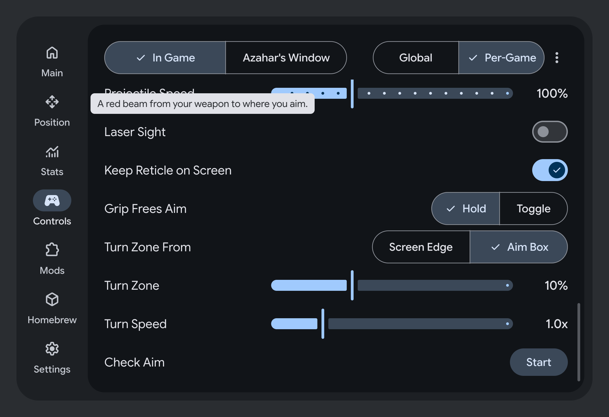

# Angel's Aim

A direct-aim, light-gun-style mode for Kid Icarus: Uprising in [Azahar for Frame](https://github.com/simplysanatori/AzaharFrame), on the Steam Frame.

Alpha Pre-Release · Very Experimental · Have Fun!

**None of this would have been possible without Darkshade's [Kid Icarus: Uprising C-Stick & Gyro patch](https://gbatemp.net/threads/kid-icarus-uprising-c-stick-gyro-patch.685775/). Thank you, Darkshade.**

## Features

- Point your controller: the reticle goes exactly where you point on the screen
- Point near or past the screen's edge to turn the camera (Turn Zone)
- 3D models of all 108 of the game's weapons: Pit's equipped one is in your hand
- Shots, muzzle flash and laser sight leave the weapon's muzzle
- A short buzz on each real shot
- **Gyro Aim** instead, if you'd rather turn your hand

## How it works

- The weapon models are built on your Frame, from your own copy of the game. Nothing from the game is hosted or shipped.
- They're made in the background while you play, then kept.
- It runs only while Kid Icarus: Uprising is open.
- It's a first step toward a full Kid Icarus: Uprising recompilation.

## Requirements

- Azahar for Frame 1.2.0 or later
- Your own copy of Kid Icarus: Uprising (tested on the USA version)
- Darkshade's C-Stick & Gyro patch (v172), installed from the app
- Recommended: the [Kid Icarus: Uprising HD](kid-icarus-uprising-hd.md) texture pack

## Set up

1. Start the game and open the in-game menu.
2. Go to **Mods**, then **Angel's Aim**.
3. Under **Required**, install **C-Stick & Gyro**, or its 16:9 or 21:9 version. Then start the game again.
4. Get **Kid Icarus Uprising Weapons HD** from **Textures**, **Download Packs**, and turn it on.

**Aiming** starts on **Direct Aim** once the patch is installed. **Aiming Settings** in the same segment opens the rest.

*Aiming, recoil strength and the weapon in your hand.*

## Settings people look for

- **Grip Frees Aim**: hold the aiming controller's grip to point at the bottom screen or a menu.
- **Turn Zone**, **Horizontal Turn Speed** and **Vertical Turn Speed**: where turning starts, and how fast.
- **Weapon in Hand**: the weapon's size, opacity, muzzle flash and projectiles.

*Muzzle flash and projectiles, with their size and speed.*

*Direct Aim: laser sight, keeping the reticle on screen, and the Turn Zone.*

Every setting: [Angel's Aim in the user guide](https://github.com/simplysanatori/AzaharFrame/blob/steam-frame/docs/USER_GUIDE.md#angels-aim-kid-icarus-uprising).

## Weapons HD texture pack

[Kid Icarus: Uprising HD](kid-icarus-uprising-hd.md) upscales the weapon textures 4x. The weapon in your hand uses it too.

## Roadmap

- Planned: full immersion mode, a full 6DOF experience
- Planned: weapons that move in your hand as they do in the game
- Planned: Pit's arm on your other hand
- Planned: a full Kid Icarus: Uprising recompilation

## Troubleshooting

- **The reticle doesn't follow your controller.** Check the patch shows **Installed**, then start the game again.
- **Direct Aim does nothing in Immersive Mode.** Set **Immersive Mode** to **Off** for this game.
- **Something's wrong, or you have an idea.** Use **Report an Issue** or **Send Report** in the **Angel's Aim** segment.

## Credits

- [Darkshade](https://gbatemp.net/threads/kid-icarus-uprising-c-stick-gyro-patch.685775/): the C-Stick & Gyro patch Angel's Aim is built on
- [simplysanatori](https://github.com/simplysanatori): [Kid Icarus: Uprising HD](kid-icarus-uprising-hd.md), made with DXTDecompressor and the 4x-UltraSharp model by Kim2091
