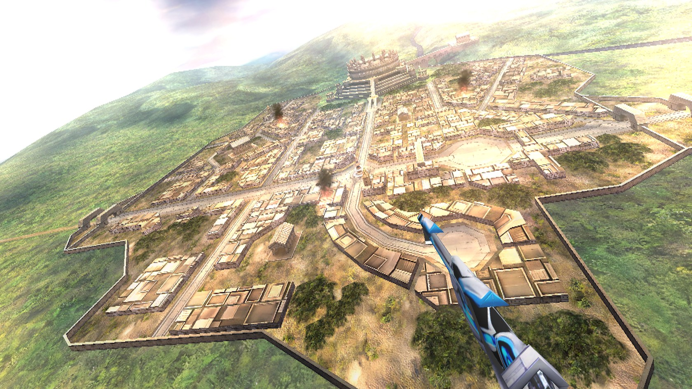
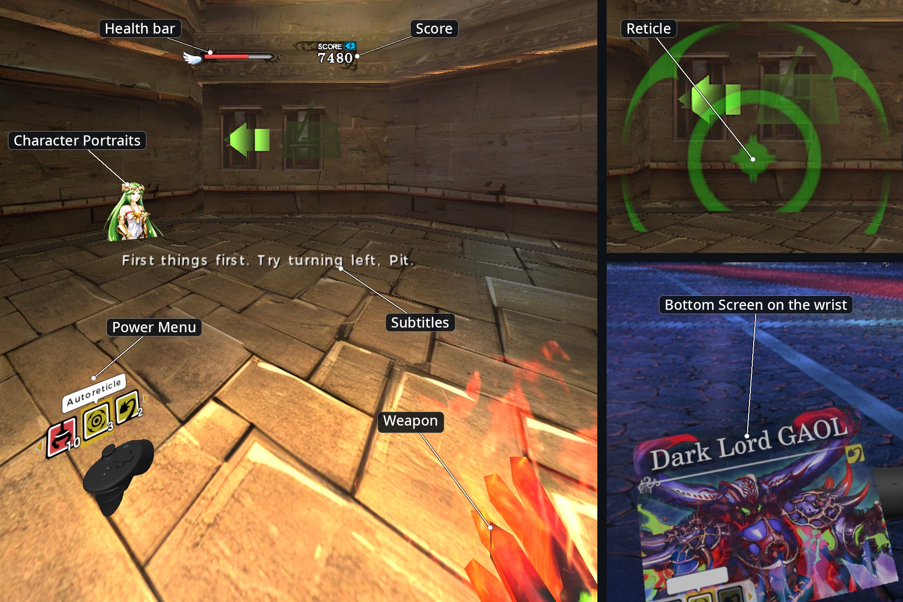
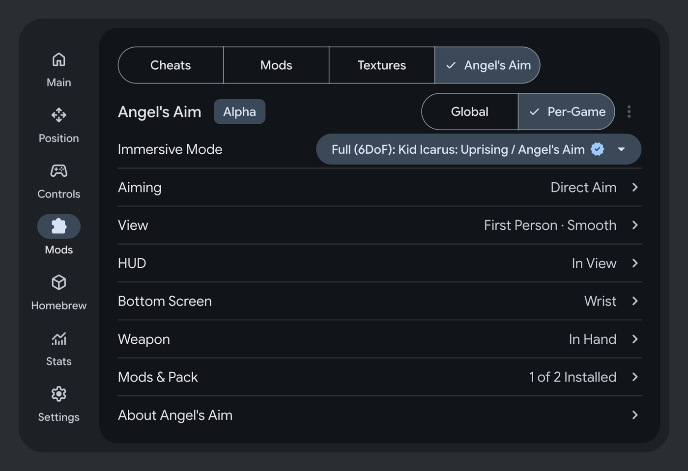
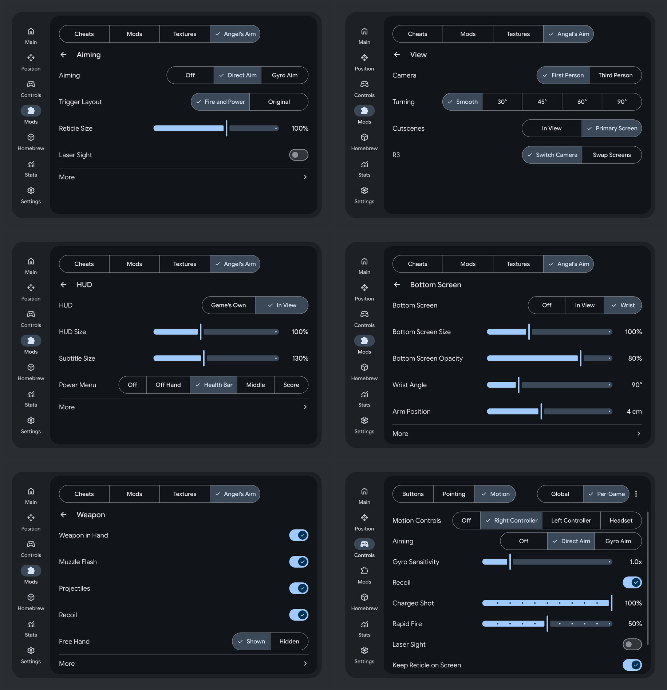

# Angel's Aim

**Kid Icarus: Uprising in first-person 6DoF.** A mod for [Azahar VR](https://github.com/simplysanatori/AzaharVR), on the Steam Frame and PC VR.

Alpha Pre-Release · Very Experimental · Have Fun!

**None of this would have been possible without Darkshade's [Kid Icarus: Uprising C-Stick & Gyro patch](https://gbatemp.net/threads/kid-icarus-uprising-c-stick-gyro-patch.685775/). Thank you, Darkshade.**

> Recommended texture pack: **[Kid Icarus: Uprising HD](kid-icarus-uprising-hd.md)**. The whole game's textures at 4x.

## Two ways to play

- **Immersive:** first-person 6DoF
- **Widescreen:** Darkshade's C-Stick & Gyro mod in 16:9, with Direct Aim or Gyro Aim

## Features

- 6DoF head and aim, on land and in the air
- First Person and Third Person
- 108 weapon mesh models
- Muzzle flash, projectiles, haptic feedback
- Health bar, score and subtitles in view
- Cutscenes and the goddess's room in VR
- Bottom Screen placement: Wrist or In View
- Power Menu (off by default)
- Character Portraits (off by default)

## Requirements

- [Azahar VR](https://github.com/simplysanatori/AzaharVR/releases) 1.4.0 or later
- Your own copy of the game: European (Rev 0) or USA (Rev 1)

Nothing from the game is hosted or shipped.

## Start

**Immersive**

- European version: start the game.
- USA version: set **Mods** > **Angel's Aim** > **Immersive Mode** to **Full (6DoF): Kid Icarus: Uprising / Angel's Aim**.

**Widescreen**

1. Set **Immersive Mode** to **Off**.
2. Install **Widescreen 16:9** under **Mods** > **Angel's Aim** > **Mods & Pack**.
3. Restart the game.

## Controls

**Trigger Layout** on **Fire and Power**:

| | |
|---|---|
| Fire | Aiming hand's trigger |
| Power, special attack | Other trigger |
| Pick a power | Bumpers |
| Turn (land) | Right stick |
| First Person / Third Person (battles) | R3 |
| Reset Screens and View | Hold R3 |

## Options

In **Mods** > **Angel's Aim**, with the game running:

| | |
|---|---|
| **Aiming** | Aiming, Trigger Layout, Reticle Size, Laser Sight |
| **View** | Camera, Pit Opacity, Turning, Cutscenes, R3 |
| **HUD** | Size, place, Subtitle Size, Power Menu |
| **Bottom Screen** | In View, Wrist, Wrist Angle, Arm Position, Character Portraits |
| **Weapon** | Size, opacity, effects, Recoil, Free Hand |

All options: [user guide](https://github.com/simplysanatori/AzaharVR/blob/steam-frame/docs/USER_GUIDE.md#angels-aim-kid-icarus-uprising).

## Troubleshooting

- **No first person:** check the game's version and **Immersive Mode**.
- **"C-Stick Mod Loaded":** restart the game.
- **Anything else:** **About Angel's Aim** > **Report an Issue** or **Send Report**.

## Planned

- 60 FPS option
- Melee by swinging
- Weapons that move as in the game

Angel's Aim is the mod for Azahar VR. The plan for later is a standalone, probably called Uprising VR.

## Credits

- [Darkshade](https://gbatemp.net/threads/kid-icarus-uprising-c-stick-gyro-patch.685775/): the C-Stick & Gyro patch
- [Azahar](https://github.com/azahar-emu/azahar) and CitraVR
- [simplysanatori](https://github.com/simplysanatori): Angel's Aim and [Kid Icarus: Uprising HD](kid-icarus-uprising-hd.md)
