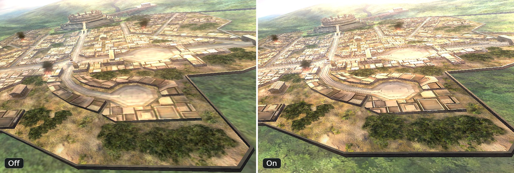
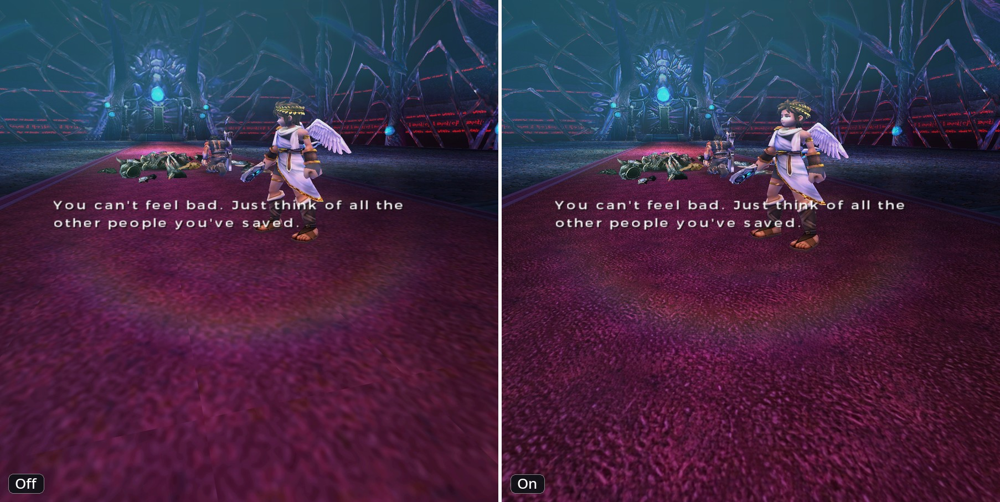

# Kid Icarus: Uprising HD

An HD texture pack for Kid Icarus: Uprising. The whole game's textures at 4x.

Version 1.4.1, by [simplysanatori](https://github.com/simplysanatori) and Darkshade.

## What's in it

- 9,706 textures, about 2.9 GB
- Stages, skies, weapons, enemies, effects, items, menus
- Boss name cards and other text, redrawn in English
- Official artwork for food, items and the gallery

Not in it: Pit's body. HUD text is upscaled, not redrawn.

## Requirements

- [Azahar VR](https://github.com/simplysanatori/AzaharVR) or Azahar
- European version (`0004000000030200`) or USA version (`0004000000030100`; 20 text pictures stay original)

## Install

**Azahar VR:** **Mods** > **Textures** > **Download Packs** > **Kid Icarus: Uprising HD**.

**Azahar:**

1. Get [the zip](https://drive.google.com/file/d/1MXvVcxroJM_p4XEDFPs5L7Dy_VUI1jhN/view).
2. Copy what's inside its folder into `load/textures/0004000000030200/` (European) or `load/textures/0004000000030100/` (USA).
3. Turn on **Use custom textures**.

## Credits

- [simplysanatori](https://github.com/simplysanatori): the pack
- Darkshade: contributor
- Kim2091: 4x-UltraSharp, 4x-AnimeSharp
- DXTDecompressor

## Licence

Free for emulators; credit the author, [simplysanatori](https://github.com/simplysanatori).
