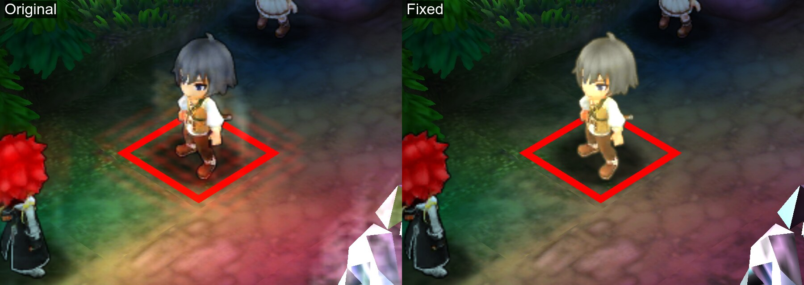
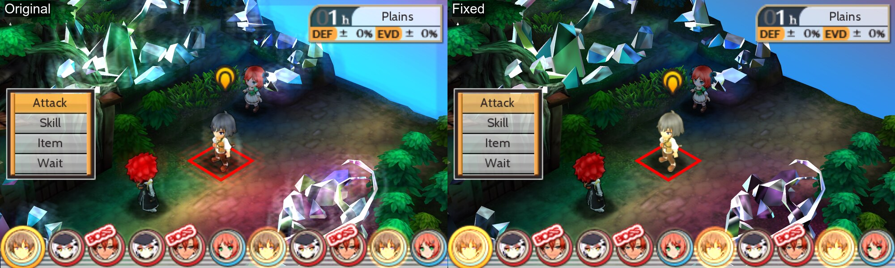
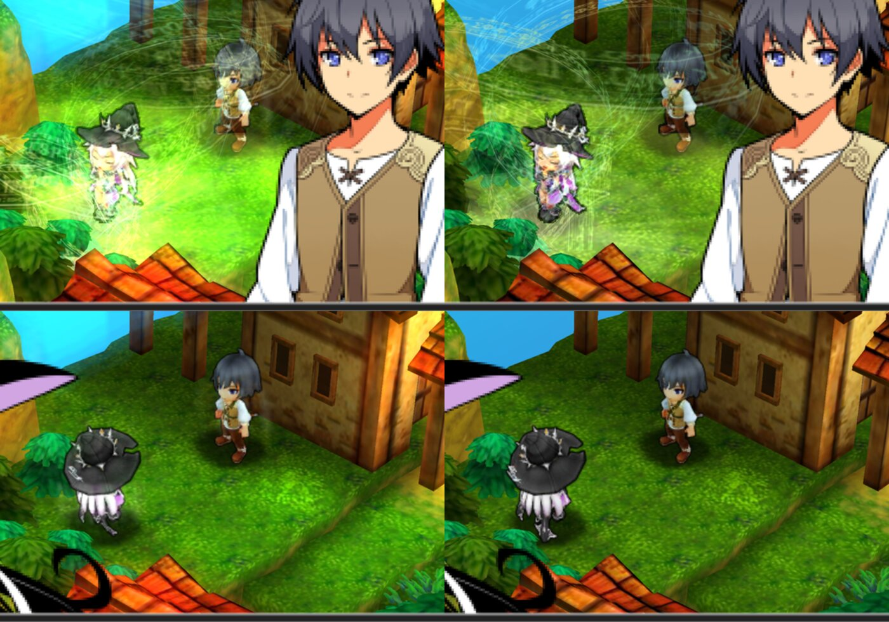

# Stella Glow (USA): No Bloom

Removes the ghostly glow and outlines around characters when you raise the internal resolution.

The red battle cursor and the ground under it were the worst. Full screen:

The character's hair colour changes between shots because the game pulses the selected unit. That's not the fix.

## The problem

- At 1x, the game draws a soft glow around characters.
- Above 1x, the glow turns into sharp ghost copies of each character. It gets worse at every step.
- HD texture packs don't fix it. The glow isn't a texture.

## What the fix does

It turns off the game's glow effect. The rest of the picture stays the same. At 1x the scene looks slightly darker, since the soft glow is gone too.

## Game

- Stella Glow, USA cartridge release
- Title ID `0004000000173700`

## Another example

## Install

Copy `patch/0004000000173700/code.ips` into the game's mods folder. Steps for each emulator are in the [main README](../../README.md#install).

Cheat instead: copy the code from `cheats/0004000000173700.txt` into your cheat list and turn on **No Bloom (USA)**.

## Tested

- Azahar 2125.0.1 at 6x: patch works; cheat works on its own from a fresh boot
- Title screen: unchanged by the fix
- Zakuro at 1x and 4x: cheat works
- Not tested yet: patch in Zakuro, real 3DS, Citra

## More

[AGENTS.md](AGENTS.md): how the glow is drawn, why upscaling breaks it and what the patch changes.
